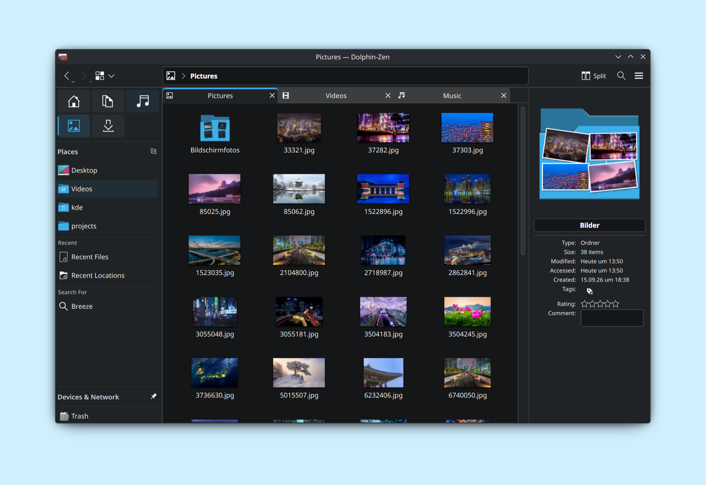
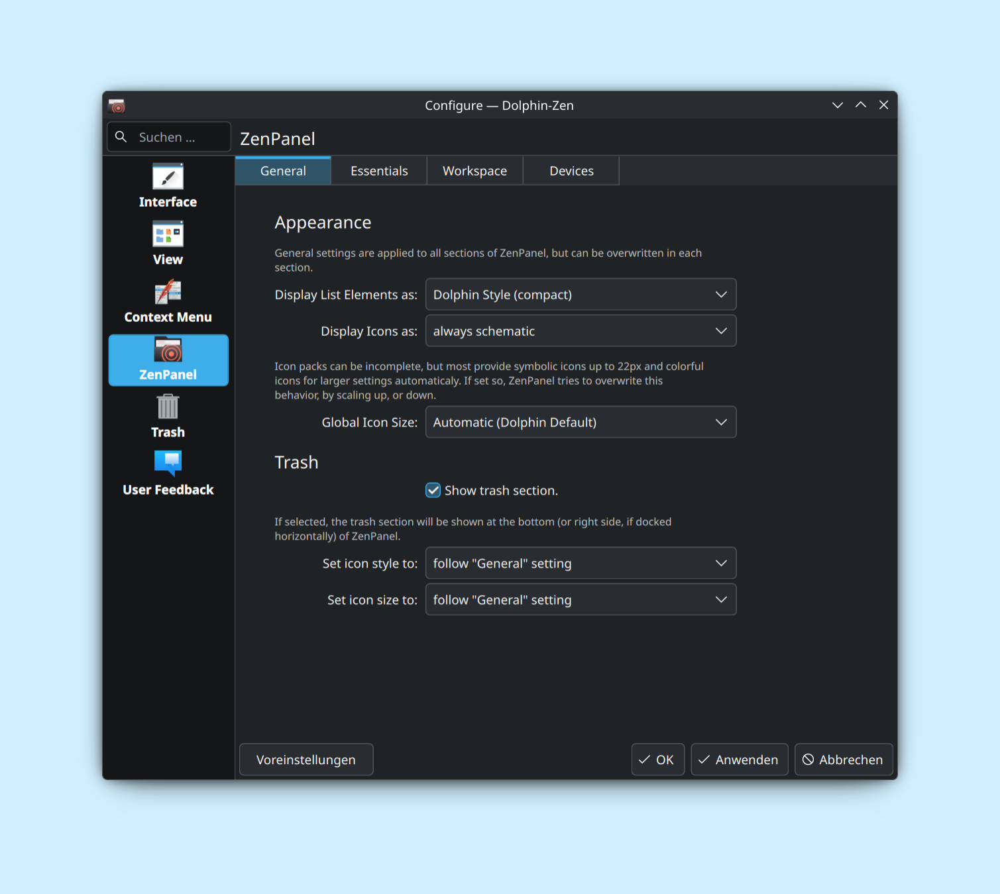
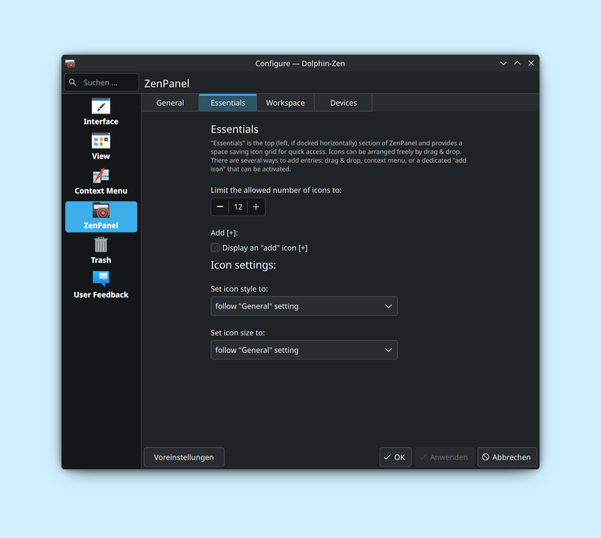
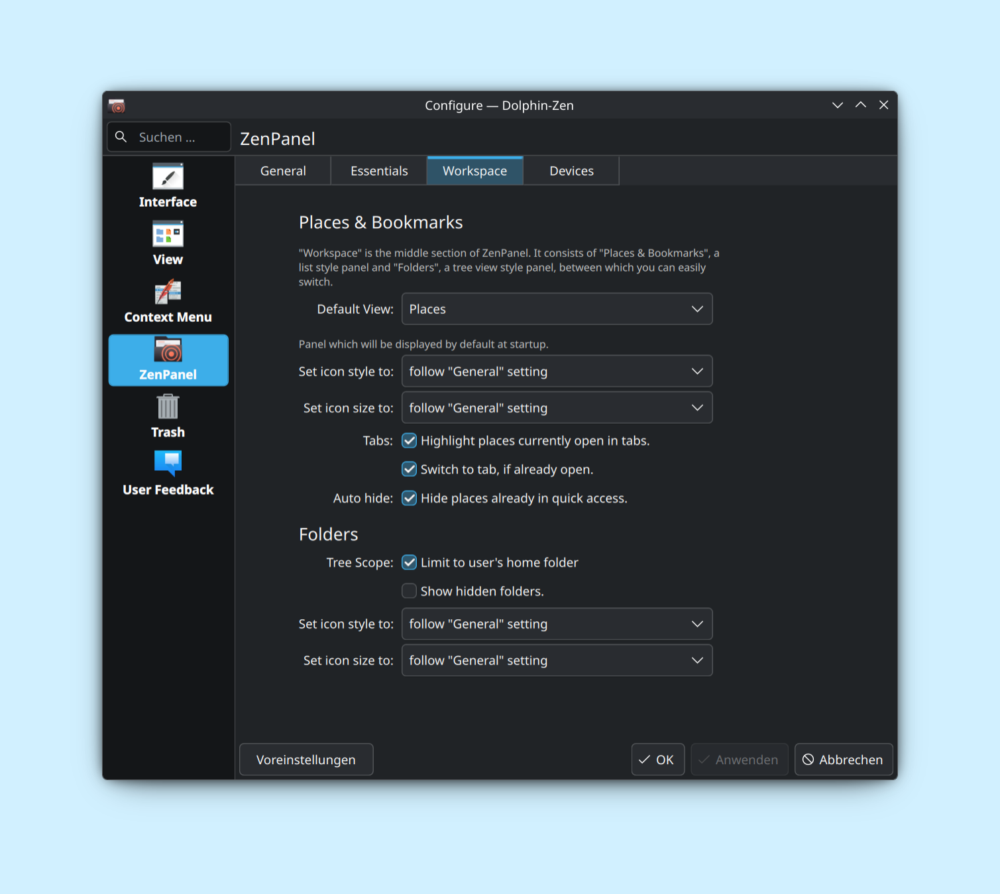
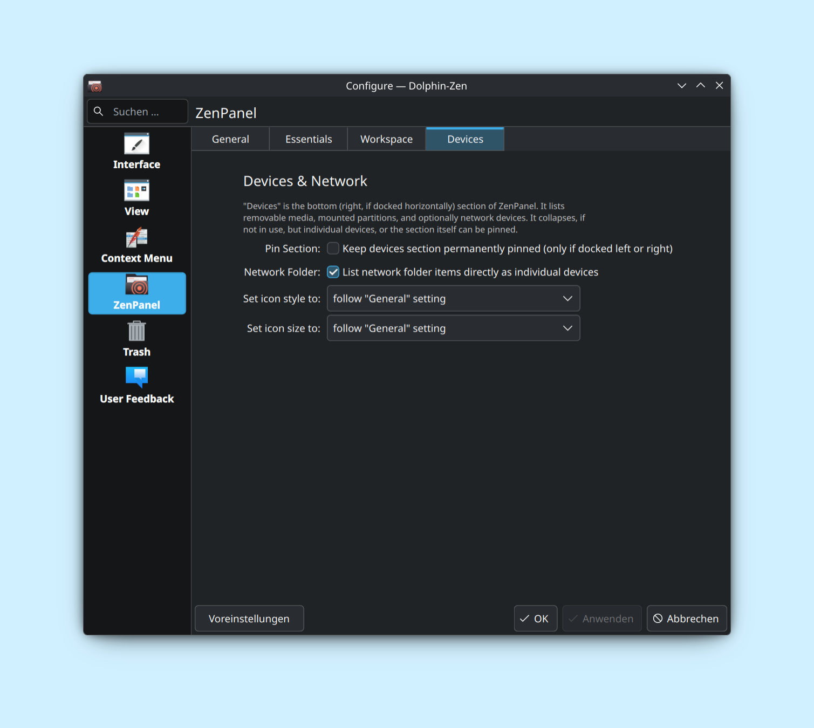
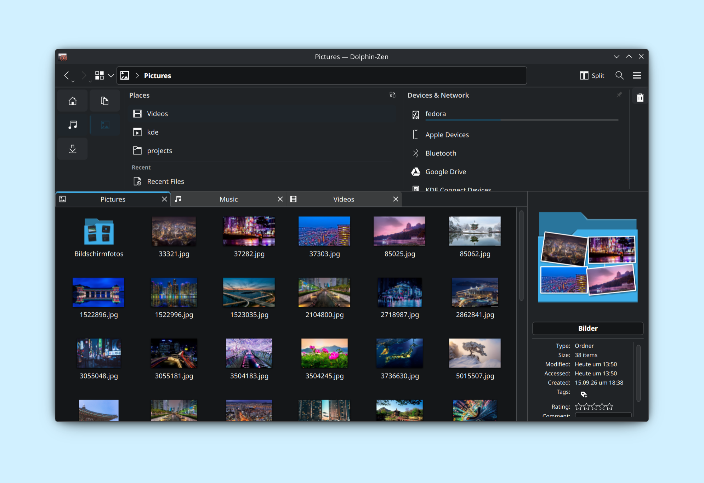

# Dolphin-Zen

**Dolphin-Zen** is a fork of [KDE Dolphin](https://apps.kde.org/dolphin/), enhanced with the native **ZenPanel** — a modern QtQuick / Kirigami sidebar inspired by the awesome Zen Browser [Zen Browser](https://zen-browser.app/).

> [!NOTE]
> **Dolphin-Zen is currently based on Dolphin 26.08.2**  
> Every Feature of Dolphin should be preserved and still be functional.
> Dolphin-Zen and Dolphin should be ABI compatible, so they should be able to run side-by-side.
> I made it for my personal use - no support is promised. No Feature is promised. No Bugfix is promised. No Stability is promised.

---

## Impressions

| ZenPanel Overview | ZenPanel Sections Style & Size Mix | ZenPanel Settings General | ZenPanel Settings Essentials | ZenPanel Settings Workspace | ZenPanel Settings Devices | ZenPanel Horizontal Docking | ZenPanel FolderTree | ZenPanel Pinned Devices Section
| :---: | :---: | :---: | :---: | :---: | :---: | :---: | :---: | :---: |
|  |  |  |  |  |  |  |  |  |

---

## Features Added by ZenPanel

* **Essentials (Quick Access):** Icon only Grid to save Space
* **Open Tabs Highlighting:** Open Taps are highlighted. You even can set "jump to open tab".
* **Customizable Layout Settings per Section:**
  * Switch between always symbolic Icons, always colorful, or just follow System Theme depending on Icon size.
  * Set Icon size for each section individually.
* **Keyboard Accessibility:**
  * <kbd>F8</kbd>: Toggle Zen Panel visibility.
  * <kbd>Ctrl</kbd>+<kbd>Shift</kbd>+<kbd>Z</kbd>: Quick focus swap between Zen Panel and the main Dolphin file view.
* **Integrated Configuration:** ZenPanel Settings are integrated in to the Dolphin Settings Dialog.
* **Horizontal Docking:** Dock ZenPanel top or bottom - useful, or not, you can do it. If docked horizontally, the sections of ZenPanel will be placed side by side.

---

## Upstream Lineage, Authorship & Licensing

* **Upstream Codebase:** [KDE Dolphin](https://invent.kde.org/system/dolphin) is developed and maintained by the **KDE Community** under the **GNU General Public License v2 or later (GPL-2.0-or-later)**.
* **Zen Panel Additions:** Designed and developed by me **dev-Meow** under the **GNU General Public License v2 or later (GPL-2.0-or-later)**.
* **Open Source Standards:** All source files, comments, and licensing metadata strictly follow the **REUSE Specification** and international KDE Community guidelines.

---

## Building & Running

### Prerequisites

* KDE Frameworks 6 (KF6) & Qt 6.5+ (including `Qt6Declarative`, `Qt6QuickControls2`)
* `extra-cmake-modules`, `cmake`, `ninja` (or `make`), `gcc-c++` or `clang`

### Native Build

```bash
cmake -B build -S . -DCMAKE_BUILD_TYPE=Release -DBUILD_TESTING=ON
cmake --build build -j$(nproc)
```

### Launching

Run the local build with full desktop theme and icon integration:

```bash
./run-dolphin-zen.sh
```

### Running Contract Tests

```bash
ctest --test-dir build -R zenhostinterfacetest --output-on-failure
```

---

## 📦 Flatpak

Dolphin-Zen can be built and packaged as a standalone Flatpak sandbox using the provided manifest:

```bash
flatpak-builder --user --install --force-clean build-flatpak org.kde.dolphin-zen.json
flatpak run org.kde.dolphin-zen
```

---

## Original Dolphin Documentation & Community

Dolphin is KDE's file manager that lets you navigate and browse the contents of your hard drives, USB sticks, SD cards, and more. Creating, moving, or deleting files and folders is simple and fast. See more information [on Dolphin's homepage](https://apps.kde.org/dolphin/).

### User Documentation

See <https://userbase.kde.org/Special:myLanguage/Dolphin>.

### Contributing Upstream

Like other projects in the KDE ecosystem, contributions are welcome from all. The upstream repository is managed in [KDE Invent](https://invent.kde.org/system/dolphin), our GitLab instance.

* Want to contribute code? See the [GitLab wiki page](https://community.kde.org/Infrastructure/GitLab) for a tutorial on how to send a merge request.
* Reporting an upstream bug? Please submit it on the [KDE Bugtracking System](https://bugs.kde.org/enter_bug.cgi?format=guided&product=dolphin). Please do not use the Issues tab to report bugs.
* Is there a part of Dolphin that's not translated? See the [Getting Involved in Translation wiki page](https://community.kde.org/Get_Involved/translation) to see how you can help translate!

If you get stuck or need help with anything at all, head over to the [KDE New Contributors room](https://go.kde.org/matrix/#/#kde-welcome:kde.org) on Matrix. For questions about Dolphin, please ask in the [KDE File Management room](https://go.kde.org/matrix/#/#kde-fm:kde.org). See [Matrix](https://community.kde.org/Matrix) for more details.

### Development Philosophy

Dolphin is a file manager focusing on usability. When reading the term Usability people often assume that the focus is on newbies and only basic features are offered. This is not the case; Dolphin is quite full-featured, but the features are carefully chosen so as to not impede any of the users in the target user groups.

#### Target User Groups

Focusing on usability means that features are discoverable and efficient to use. The feature set is defined indirectly by the target user group of Dolphin:

* **Lisa**: Lisa has been familiar with computers for 10 years. From her job, she has experience with Word, Excel and Outlook. At home she mainly uses the computer for browsing the web and writing e-mails. She requires a file manager for managing photos from the camera, documents she gets via e-mail, or PDFs she downloads with a browser. Lisa knows concepts like folders and a file hierarchy, but she is not familiar with the file hierarchy of Linux.

* **Simon**: Simon has been a developer at a software company for 8 years. At home he uses a file manager to maintain his large collection of photos and music. Additionally he owns a small homepage and needs to transfer updated files on the FTP server. Moving and copying files are regular tasks in Simon's workflow.

Not part of the target user group of Dolphin are Fred and Jeff:

* **Fred**: Fred is 75 years old and is able to write e-mails and browsing the web. He is not familiar with file hierarchies and stores all his documents on the desktop.

* **Jeff**: Jeff is Linux-freak since the age of 16 a few years ago. He is a developer and in his spare time he acts as administrator for a small company. Jeff has two monitors to keep the overview about his huge number of opened applications.

This does not mean that Fred or Jeff cannot work with Dolphin. But there might be features and concepts of Dolphin that overburden Fred. Also Jeff might miss some features which are a must-have for his daily work. This is acceptable; there are other tools that cater specifically to their needs.

#### Non-Intrusive Features

Before a feature is added in Dolphin, check whether the feature is mandatory for the target user group. If this is not the case, then this does not mean that the feature cannot be added; first it must be clarified whether the feature might be non-intrusive, so that it adds value for users outside the primary target user group of Dolphin. The term "non-intrusive" is mainly related to the user interface. A feature that adds a lot of clutter to the main menu, context menus or toolbar might harm the target user group. In this case the feature should not be added.

A good example of a feature that is non-intrusive is the embedded terminal in Dolphin. It only requires one entry inside a sub-menu, but adds great value for Jeff, who is not part of the target user group.

#### Options

Options are mandatory as the "average Joe" user does not exist. Still it is not the goal of Dolphin to offer options for all kind of things. Again the focus is on the possible needs of the target user group. Each additional option makes it harder finding other options, so the same rules for features are applied to options too.
